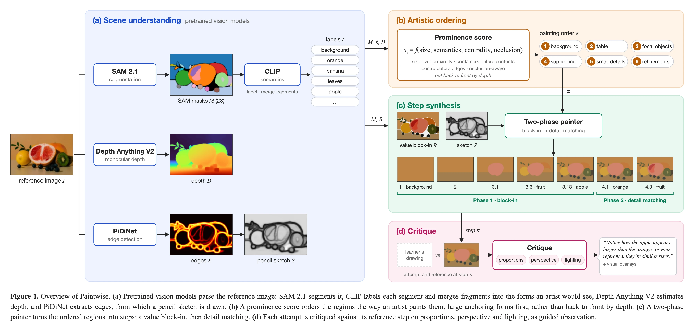
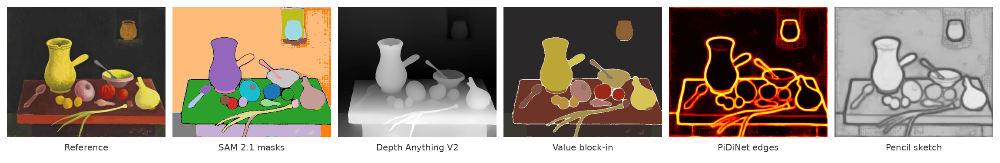
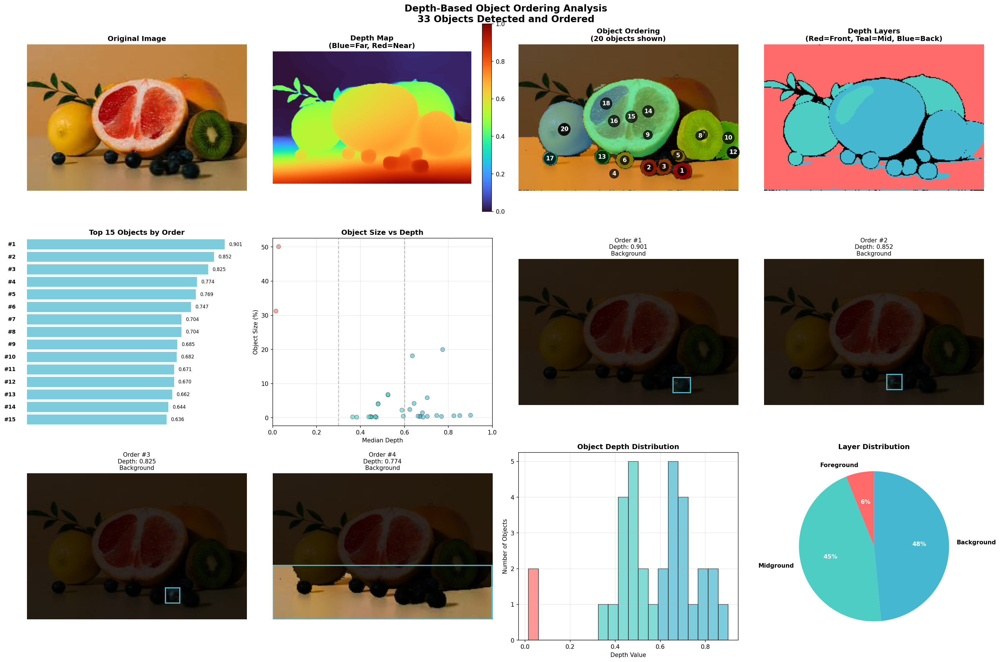
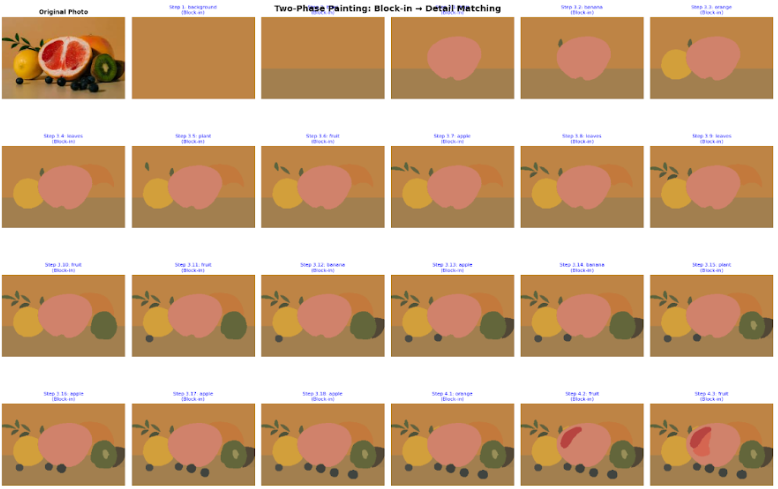
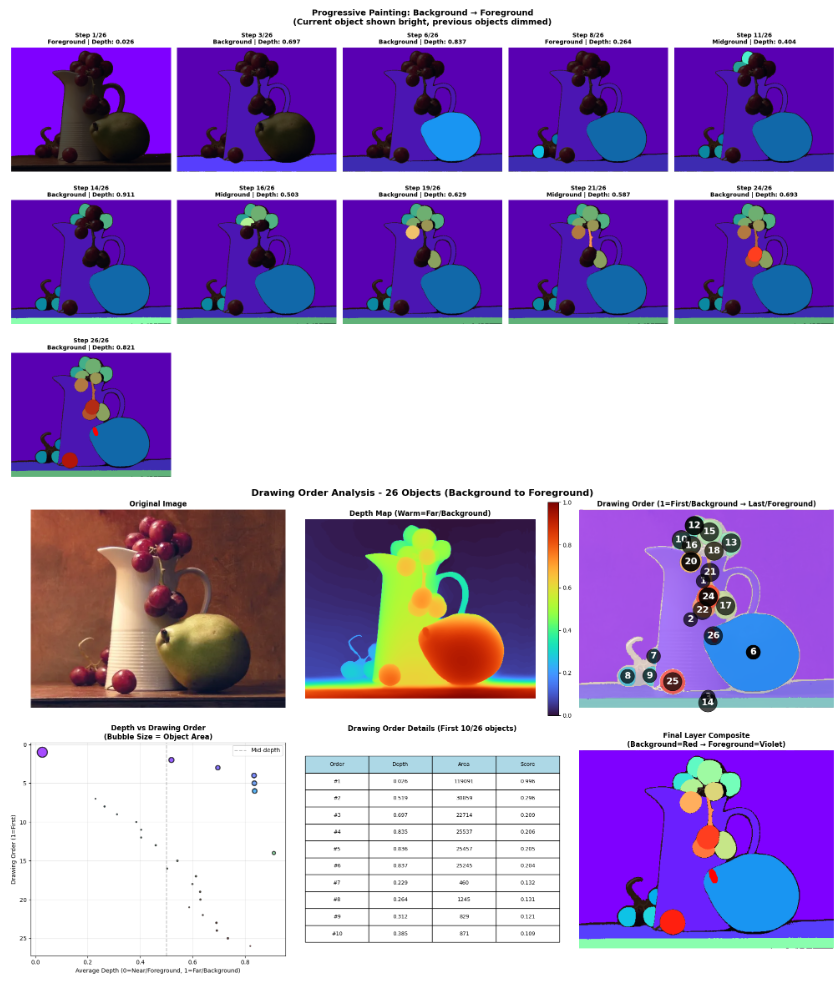
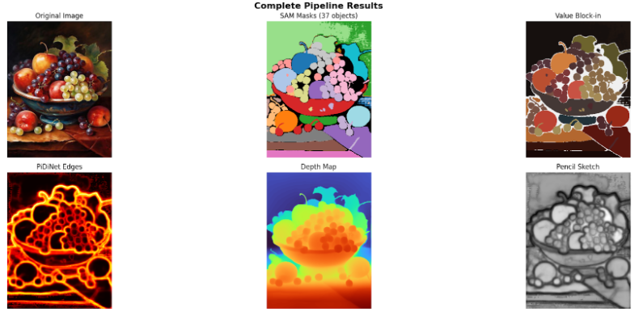
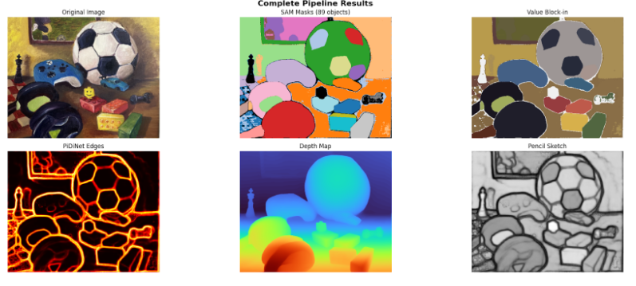
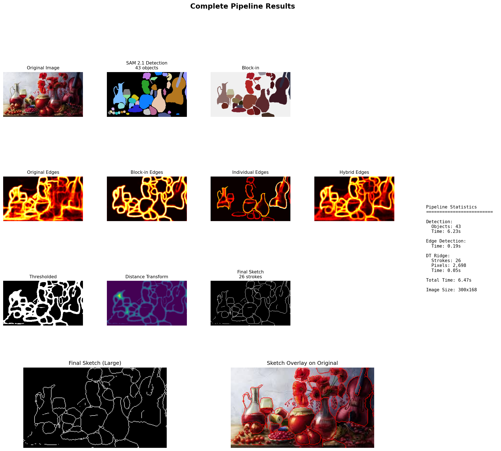
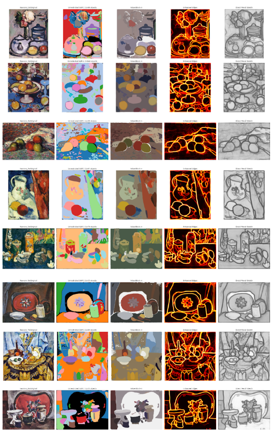
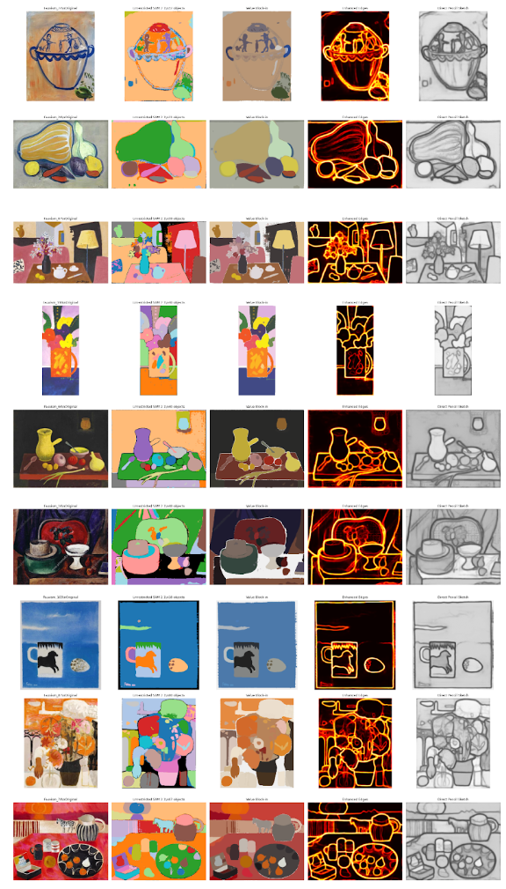

<p align="center">
  
</p>

<h1 align="center">Paintwise</h1>

<p align="center">
  <b>Teaches you to paint a picture the way an artist would, one step at a time.</b><br>
  A computer-vision pipeline that turns any reference painting into an artist-ordered lesson, from first block-in to final detail.
</p>

<p align="center">
  <a href="https://aayushs-portfolio.netlify.app/paintwise">Build log</a> ·
  <a href="https://aayushs-portfolio.netlify.app">Portfolio</a> ·
  <a href="#how-it-works">How it works</a> ·
  <a href="#results">Results</a>
</p>

<p align="center">
  
  
  
  
  
  
</p>

---



## Why

If you want to learn to draw, YouTube is where you go. But following along with a video isn't the same as being taught, and good art teachers aren't always available or affordable.

Most generative AI is built to produce a finished image. Artists don't work that way: the learning happens in the in-between stages, the rough shapes that map out a form, the flat value block-in, the gradual refinement into light and shadow. To *teach* art, a system has to understand those stages, not just the destination.

Paintwise is built around two halves:

1. **Step synthesis.** Given a reference image, generate the sequence of steps an artist would actually paint, ordered the way an artist thinks.
2. **Critique** *(in progress)*. As the learner follows along, compare each attempt to the matching step and give feedback on the three things you can judge objectively in realistic work: **proportions, perspective, and lighting.**

The step-synthesis half is built and lives in this repo; critique is the next stage.

## How it works

The pipeline has four stages (Figure 1 above).

### (a) Scene understanding

Pretrained vision models parse the reference image into the layers an artist reasons about:

| Model | Role |
|---|---|
| **SAM 2.1** | Segments the image into object masks (automatic mask generation, hiera-large) |
| **CLIP** (ViT-B/32) | Labels each segment semantically (background, table, container, fruit, …) so ordering knows *what* it is painting |
| **Depth Anything V2** | Monocular depth, so the system knows what sits in front of what |
| **PiDiNet** | Edge detection; the edges are then turned into a pencil-sketch underdrawing |

Raw SAM output is far too fragmented for painting, so the segmenter adds an anti-oversegmentation pass: it filters texture fragments (wood grain, glints, shadow bands) and merges adjacent colour-homogeneous regions, so a wall or tabletop comes back as one form.



### (b) Artistic ordering

Painting strictly back to front by depth is technically correct and artistically wrong. Artists paint by **prominence**: a large vase in the middle ground gets established before tiny berries in the foreground. CLIP first sorts regions into layers (background → table → objects), then every object on the table gets a prominence score from its area $A_i$ and normalised depth $d_i$:

$$p_i = 0.7\,\frac{A_i}{HW} + 0.3\,(1 - d_i)$$

with a boost for objects near the horizontal centre and a penalty for very small ones.

- **Size over proximity:** area is weighted more than depth, so large anchoring forms come before small foreground details
- **Containers before contents:** CLIP's semantic labels put the bowl before the fruit inside it
- **Centre before edges:** compositional focus gets priority
- **Occlusion-aware:** pairwise overlap and depth checks decide which object occludes which

The resulting order follows how a painter works: background → table surface → focal objects → supporting objects → small details → refinements.



**Completing hidden shapes.** A painter blocks in the whole apple, even the part hidden behind the jug. Paintwise does the same. It walks objects back to front and grows each mask into the region its foreground occluders cover (a depth-constrained geodesic expansion, guided by the object's convex hull). It never grows into space a nearer object has already claimed.

I tried several ordering strategies along the way and compared them side by side in the notebook: a pure depth + size heuristic, depth grouping with occlusion resolution, CLIP semantic ordering, and a BLIP-captioning variant. The layered prominence approach above is the one that reads most like an artist.

### (c) Step synthesis: a two-phase painter

The ordered regions become concrete steps in two phases: a **value block-in** (one flat value per region, laid down in prominence order), then **detail matching** that refines each form toward the reference.



The same ordering drives a progressive render, with each object painted onto the canvas in turn from background to foreground:



*Experimental:* the notebook also explores SDXL + ControlNet (edge and depth conditioning) to paint each SAM region in stages with regional diffusion, as a route to more painterly intermediate steps.

### (d) Critique: in progress

> This stage is designed but not yet implemented in this repo.

The plan: compare each attempt to its reference step along three axes: **proportions** (visual relationships, not raw ratios), **perspective** (spatial coherence), and **lighting** (value consistency). Feedback is phrased as guided observation instead of error scores. Rather than *"your proportions are 23% off,"* the goal is something like *"Notice how the apple appears larger than the orange: in your reference, they're similar sizes,"* with visual overlays showing where to look.

## Results

**Full pipeline on a fruit-bowl still life.** SAM finds 37 objects; the block-in, edge map, depth map and sketch follow.



**A cluttered scene (89 objects).** Overlapping toys, strong occlusion and mixed scales.



**From edges to strokes.** To get a clean underdrawing from PiDiNet's soft edges, the pipeline thresholds them, takes a distance transform, and traces its ridges into a small set of strokes (26 here). It runs in about 6.5 s per image, most of it in SAM.



**Batch runs across varied still lifes.** Different styles, palettes and levels of abstraction. Columns: original → SAM 2.1 masks → value block-in → enhanced edges → pencil sketch.

<table>
  <tr>
    <td></td>
    <td></td>
  </tr>
</table>

## Engineering challenges

The [build log](https://aayushs-portfolio.netlify.app/paintwise) covers these in depth. The short version:

**Segmentation that sees too much.** SAM 2.1 is very good at its job. Where an artist sees one wooden table, SAM sees dozens of pieces: grain, reflections, shadow bands. Paintwise post-processes the masks, filtering texture fragments and merging colour-homogeneous neighbours back into the forms an artist would draw, with CLIP saying which form is which. It also treats the table as a *stage*: one continuous surface painted underneath everything, not a set of visible scraps.

**Depth isn't drawing order.** Ordering purely by Depth Anything V2 broke the natural flow of a painting, because small foreground details got painted first. The prominence score above came from studying how artists actually sequence a still life.

**Designing critique that feels human** *(next)*. Mechanical precision isn't what makes good art: a mathematically perfect circle often looks wrong in perspective. So the critique stage is being designed to train the learner's eye, not to hand back a list of numeric errors.

## Repository structure

```
paintwise/
├── notebooks/
│   ├── paintwise_pipeline.ipynb    # main pipeline: segmentation → edges → sketch → depth → ordering → steps
│   └── sketch_experiments.ipynb    # earlier R&D: SAM vs SAM 2.1, edge thinning, DT-ridge sketches, batch runs
├── src/                            # pipeline stages exported from notebook cells
│   ├── run_full_pipeline.py        # standalone runner: SAM 2.1 + Depth Anything V2 + ordering
│   ├── depth_ordering_grouped.py   # robust depth scoring + grouping objects into painting steps
│   ├── depth_ordering_cell.py      # depth-based ordering with visualisation
│   ├── pipeline_settings_widget.py # interactive settings UI for the full pipeline
│   ├── run_pipeline_cell.py        # notebook-cell version of the full run, with settings
│   ├── run_pipeline_simple.py      # notebook-cell version, no widgets
│   └── update_cell21.py            # adds occlusion-aware mask completion to the ordering cell
├── images/                         # test still lifes (+ generated sketches in images/sketches/)
├── assets/                         # README figures
├── requirements.txt
└── setup.sh                        # downloads model weights where the notebooks expect them
```

The notebooks keep their outputs, so you can read the results on GitHub without running anything.

## Getting started

Paintwise was developed on a Lightning AI GPU studio (Python 3.10, CUDA). A GPU is strongly recommended: SAM 2.1 large is slow on CPU.

```bash
git clone https://github.com/aayushs-edu/paintwise.git
cd paintwise
pip install -r requirements.txt   # install a CUDA build of torch first
./setup.sh                        # SAM 2.1 + Depth Anything V2 weights (~1.3 GB) into notebooks/
jupyter lab notebooks/paintwise_pipeline.ipynb
```

Run the **Setup** cells, pick an image in **Select Image** (it reads from `images/`), then run the numbered steps in order. PiDiNet (`lllyasviel/Annotators`) and CLIP download their own weights on first use. Model weights aren't committed to this repo.

## Related work

Paintwise builds on ideas from:

- **Inverse Painting:** reconstructing paintings the way an artist would, one region at a time and back to front
- **DeepPrimitive:** decomposing detailed images into a small set of basic shapes, like the first steps a teacher shows a beginner

It adds what those approaches lack for teaching: an understanding of *what* is being painted (objects, their relationships, and which ones matter most), with feedback on the learner's own work as the next step.

## Roadmap

- [x] Scene understanding: segmentation, semantic merging, depth, edges, sketch
- [x] Prominence-based artistic ordering
- [x] Occlusion-aware mask completion
- [x] Two-phase step synthesis (block-in → detail matching)
- [ ] Regional diffusion (SDXL + ControlNet) for painterly intermediate steps (experimental)
- [ ] Package the notebook pipeline as an importable module with a CLI
- [ ] Critique on proportions, perspective and lighting, with visual overlays
- [ ] Interactive web app for learners

## Author

**Aayush**, Computer Science at Georgia Tech. Oil painter, 3D artist, and engineer working where art and AI meet.
[Portfolio](https://aayushs-portfolio.netlify.app) · [GitHub](https://github.com/aayushs-edu)

*Paintwise began as MasterStroke in summer 2025.*
